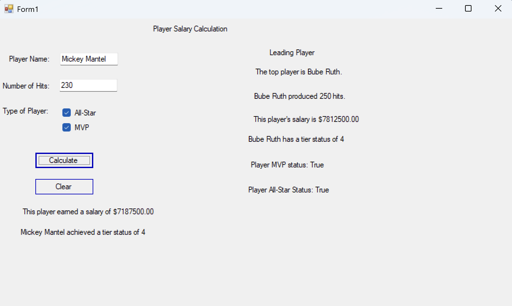

# Tiered Player Salary
## Overview
A desktop application designed to calculate baseball player salaries based on performance tiers, hit counts, and prestigious awards (All Star and MVP designations).



## 📚 Background of Creation
This program was created as an assignment for Introduction to Programming in C# through Lorain County Community College. This course was taken as the final part of my software development certificate there. Prior to this course, I had experience primarily in Java, JavaScript, HTML, and CSS. The course allowed me to become much more familiar with C# and Visual Studio as an Integrated Development Environment (IDE).

As part of the assignment, these were the instructions given:
```
Create a program that will calculate the salary a player will earn based on the following business rules. Be sure to refer to the general programming guidelines listed above. Name your project: TieredPlayerSalaryViaIF - Your Name

- Tier 1: For 1 through 49 hits in a season, the player earns $17,500 per hit for ALL hits. 

- Tier 2: For 50 through 99 hits, the player earns $20,000 per hit for ALL hits.

- Tier 3: For 100 through 149 hits, the player earns $22,500 per hit for ALL hits.

- Tier 4: For 150 or more hits, the player earns $25,000 per hit for ALL hits.

Then consider All Star and MVP (most valuable player) awards:
- If a player is neither an All Star NOR a MVP designation, then add 0% to the tiered salary you calculated above.

- If a player is both an All Star AND and a MVP, then add 25% to the tiered salary you calculated above

- If a player is only one of All Star OR a MVP, then add 20% to the tiered salary you calculated above

Note that this is a 'simple' calculation - in that once a player reaches the threshold for the next $ level per hit, the player earns that rate for ALL hits they had. For example, if Player1 had 149 hits in a season, he will earn
149 * 22,500 = $3,352,500.

However, if that Player1 would have produced one more hit (150), he would have earned 150 * 25,000 = $3,750,000. 

Then, consider the impact of the All Star and MVP attributes on the salary calculation mentioned above.

INPUT: Have the user enter the player’s name, number of hits, one checkbox to indicate if they are an All Star and a second checkbox to indicate if they are a MVP. Then use a Calculate button to process the data. Process the data only if the user enters a player’s name(any non-space characters typed in constitutes entering a name). Process the data only if the user entered a valid hit count. A valid hit count is an integer that is greater than zero, but is less than or equal to 300. 

Validate the hit count programmatically – do not use a masked textbox. Use a validation method we covered other than try..catch to perform the validation. Add a Clear button to clear the data entry fields, checkboxes and calculations.

PROCESSING/OUTPUT: Calculate the player’s earnings based on the Tier they achieved, and display the calculated salary and Tier number. Use an if () ... decision structure to determine the Tier number and $ per hit amount (do not use a switch (..case...) decision structure). Determine any additional salary amount based on All Star/MVP checkbox settings.

In addition to allowing the entry of the current player name, hits details and calculating the current player’s salary based on the above, also display a separate summary set of information on the window showing the leading player’s name , number of hits, salary and Tier number for the player who has had the most hits of all players processed so far, since the Window was opened or since the Clear button was last clicked. You only need to keep track of the ONE leading player, not all players entered in. If there are one or more ties, the first player entered who had the most hits will be the leader.
```

## 🚀 Features & Business Rules
**1. Tiered Salary Structure**

Once a player reaches a specific hit threshold, that rate applies retroactively to all hits recorded in the season:
- **Tier 1 (1–49 hits):** $\$17,500$ per hit
- **Tier 2 (50–99 hits):** $\$20,000$ per hit
- **Tier 3 (100–149 hits):** $\$22,500$ per hit
- **Tier 4 (150+ hits):** $\$25,000$ per hit 

**2. Award Bonuses**

Additional salary bonuses are added based on whether the player achieved All Star or MVP status:
- **Neither Award:** $+0\%$ bonus
- **One Award (Either All Star or MVP):** $+20\%$ bonus
- **Both Awards (All Star and MVP):** $+25\%$ bonus

## 🛠️ Application Requirements & Controls
**User Inputs**
- **Player Name:** Must not contain an empty string.
- **Hit Count:** Must be an integer between 1 and 300 (validated programmatically using if/else).
- **All Star Checkbox:** Indicates All Star designation.
- **MVP Checkbox:** Indicates Most Valuable Player designation.

**Buttons & Actions**
- **Calculate Button:** Validates inputs, processes the tier and bonus calculations using if/else decision structures (no switch statements per course instructions), and displays the tier number and final salary.
- **Clear Button:** Resets all input fields, checkboxes, and calculation displays.

## Session Leader Tracking
The application tracks and displays a separate summary panel showing the leading player with the highest number of hits processed since the window opened or since the Clear button was last pressed.

## How to Run
To run this program, clone the repository and navigate to bin/debug/TieredPlayerSalaryViaIF - Sarah Borgelt.exe. Double click on TieredPlayerSalaryViaIF - Sarah Borgelt to run the program. 

## Future Improvements
This program was designed simplistically for an introductory level course. Ideas for future additions would be to enhance this to a full-stack program with the ASP.Net core. Because this program was set up using WinForms for the course, the user experience isn't as strong as it could have been with a different user interface and framework such as React.

Other ideas for enhancements include increasing the top player list to the top 25 players and being able to "heart" a user's favorite players. There are also likely APIs available to pull in up-to-date statistics for every player, which could be a fascinating addition.